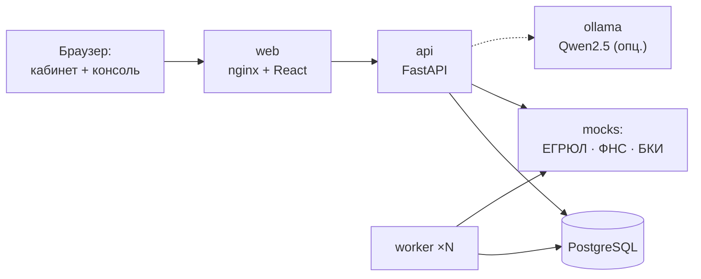

# Умный кредитный кабинет предпринимателя · Альфик

Прототип цифрового кредитного конвейера для малого и микробизнеса (хакатон Альфа-Банка). Клиентский путь и внутренняя обработка заявки объединены в один процесс: предприниматель с помощью персонажа-ассистента **Альфика** подбирает кредит, оценивает шансы, подаёт заявку, видит её движение по этапам в реальном времени, получает решение, подписывает договор и получает деньги, а банк автоматически проверяет данные, обогащает их из ЕГРЮЛ, ФНС и БКИ, оценивает риск и передаёт нестандартные случаи андеррайтеру.

<p align="center"></p>

## Главные фишки

**🎙 «Расскажите Альфику» — заявка из живой речи.** Предприниматель говорит или пишет своими словами: «нужно 2 млн на новую печь, верну за 3 года, выручка около 600 тысяч в месяц». Альфик на глазах заполняет карточку заявки, показывает, из какой фразы понял каждое значение, дозадаёт вопросы только о недостающем («а расходы?» → «примерно 420 тысяч»), подбирает продукт, считает платёж и готовность к подаче — и создаёт черновик в один клик. Голосовой ввод — через встроенное распознавание речи браузера; разбор текста — собственные правила (работают без GPU), локальная LLM лишь дополняет.

**📊 Альфик читает выписку.** Загрузите выгрузку 1С «Клиент-Банк» (стандарт любого банка РФ) или CSV — Альфик посчитает *очищенные* обороты по месяцам (без переводов со своих счетов и полученных займов), сверит с анкетой и ФНС, найдёт зависимость от одного покупателя и сезонность, предложит поправить выручку в анкете. Скоринг учитывает подтверждённые обороты, а при завышении — консервативно считает лимит по выписке.

**🌐 Три языка: русский, English, 中文.** Переключатель RU / EN / 中文 в шапке и на экране входа. Переведён весь кабинет клиента — экраны, каталог продуктов, статусы, подсказки Альфика, лента, решения банка и история заявки, а Альфик понимает рассказ на английском и китайском («I need 2 million for an oven…», «需要200万买烤炉，3年还清…», включая 万/亿 и цифры иероглифами); голосовой ввод тоже переключается на выбранный язык. Консоль андеррайтера остаётся на русском — это внутренний инструмент банка.

**🧠 Резюме Альфика для андеррайтера.** В консоли специалиста — одним блоком: профиль, сильные и слабые стороны по скорингу, расхождения анкеты с ФНС/БКИ/выпиской, риски, причина ручного рассмотрения, рекомендация движка и что проверить вручную.

## Что умеет

**Кабинет клиента (с Альфиком)**
* **Заявка из рассказа или голоса** — см. «Главные фишки».
* **Подбор кредита** — 5 вопросов о задаче → продукты с % совпадения и объяснением «почему подходит / почему нет».
* **Калькулятор** и кнопка **«Платёж слишком высокий для меня»**: Альфик подбирает сумму и срок под комфортный платёж.
* **«Каковы мои шансы?»** — оценка готовности к подаче на той же модели, что у банка, с факторами и советами; без запроса в БКИ; явно помечена как ориентир, а не обещание.
* **Заявка за 5 шагов** с автосохранением: реквизиты подтягиваются из ЕГРЮЛ, ответы из оценки шансов переносятся автоматически, долговая нагрузка считается на лету.
* **Живой статус**: трек из 5 шагов, подэтапы проверки в реальном времени, пояснения Альфика «что происходит / сколько ждать / что сделать», уведомления в кабинете.
* **Решения**: одобрение, **контрпредложение с вариантами на выбор**, запрос документов с дозагрузкой, отказ с понятной причиной и планом улучшения.
* **Подписание ПЭП в кабинете** → выдача → номер договора, счёт, график платежей.
* **Разбор выписки 1С / CSV** со сверкой оборотов — см. «Главные фишки»; примеры выписок можно скачать прямо в интерфейсе.
* **Чат с Альфиком** — гибрид: точные ответы по правилам (статус, документы, причины, расчёт) + локальная open-weights LLM для свободных вопросов.
* **Лента Альфика** — новости и советы, персонализированные по отрасли, этапу заявки и реакциям, с объяснением «почему вы это видите».

**Банк**
* **Автоматический конвейер**: приём → проверка полноты → ЕГРЮЛ/ФНС/БКИ → скоринг → кредитное решение.
* **Скоринг отделён от решения**: балльная модель риска + кредитная логика (стоп-факторы, лимит по платёжеспособности, полномочия автоматики, альтернативный продукт, контрпредложение).
* **Консоль андеррайтера**: резюме Альфика, очереди, метрики конвейера, сверка «со слов клиента vs источники», разбор факторов скоринга, сработавшие правила, рекомендация движка, ручное решение, проверка документов, журнал аудита.
* **Надёжность**: машина состояний, оптимистическая блокировка, ретраи и circuit breaker для интеграций, горизонтально масштабируемые воркеры, healthcheck'и.

## Быстрый старт (Docker)

Требования: Docker Desktop / Docker Engine 24+ с Compose v2, ~2 ГБ свободной памяти, свободные порты 8080, 8000, 8090.

```bash
docker compose up --build
```

Откройте **http://localhost:8080** → вкладка «Демо-доступ» → выберите сценарий (пароль у всех `demo`).

| Адрес | Что |
|---|---|
| http://localhost:8080 | Веб-интерфейс (кабинет клиента и консоль банка) |
| http://localhost:8000/docs | Swagger UI API |
| http://localhost:8090/docs | Swagger моков ЕГРЮЛ / ФНС / БКИ |

**С локальной LLM для Альфика** (необязательно, скачает ~2 ГБ модели Qwen2.5-3B):

```bash
LLM_ENABLED=true docker compose --profile llm up --build
```

Масштабирование воркеров конвейера: `docker compose up --scale worker=3`.

## Запуск без Docker (для разработки)

Требования: Python 3.12+ и [uv](https://docs.astral.sh/uv/), Node.js 22.12+.

```bash
# 1. Моки внешних сервисов
cd mocks && uv sync && uv run uvicorn app.main:app --port 8090
# 2. API + встроенный воркер (SQLite)
cd backend && uv sync && RUN_WORKER_IN_PROCESS=true uv run uvicorn app.main:app --port 8000
# 3. Фронтенд
cd frontend && npm ci && npm run dev   # http://localhost:5173
```

## Тестовые учётные записи

| Логин | Сценарий |
|---|---|
| `kolosok` | ООО «Колосок» (пекарня) — автоматическое одобрение → подпись → выдача |
| `flora` | ИП Смирнова (цветы) — контрпредложение |
| `stroy` | ООО «СтройМонтаж Плюс» — запрос документов → андеррайтер |
| `romashka` | ООО «Ромашка Трейд» — отказ (ликвидация) с объяснением |
| `failover` | БКИ недоступно → конвейер передаёт заявку специалисту |
| `underwriter` | Консоль кредитного специалиста |

Пароль: `demo`. Можно зарегистрировать новую компанию с любым ИНН (10/12 цифр) — моки сгенерируют для неё данные. Пошаговые сценарии проверки: **[docs/test-scenarios.md](docs/test-scenarios.md)**.

## Архитектура



Подробно: [docs/architecture.md](docs/architecture.md).

## Документация

| Документ | Содержание |
|---|---|
| [docs/architecture.md](docs/architecture.md) | Архитектурная схема, слои, технические решения, путь до продакшена |
| [docs/state-diagram.md](docs/state-diagram.md) | Диаграмма состояний заявки и роли переходов |
| [docs/data-model.md](docs/data-model.md) | ER-модель данных и переиспользование данных по ходу процесса |
| [docs/scoring-and-decision.md](docs/scoring-and-decision.md) | Скоринговая модель и логика кредитного решения |
| [docs/api.md](docs/api.md) | Описание API, ошибки, контракты моков |
| [docs/openapi.json](docs/openapi.json) | Спецификация OpenAPI |
| [docs/postman_collection.json](docs/postman_collection.json) | Коллекция запросов (сквозной сценарий + все эндпоинты) |
| [docs/test-scenarios.md](docs/test-scenarios.md) | Тестовые сценарии и тестовые данные |
| [docs/product.md](docs/product.md) | JTBD, user story map, MoSCoW, RICE, границы MVP |
| [THIRD_PARTY_NOTICES.md](THIRD_PARTY_NOTICES.md) | Сторонние компоненты, модели, смоделированные интеграции |

## Конфигурация

Все параметры — переменные окружения; шаблон в [.env.example](.env.example) (скопируйте в `.env`).

| Переменная | По умолчанию | Назначение |
|---|---|---|
| `DATABASE_URL` | PostgreSQL в compose / `sqlite:///./local.db` локально | Строка подключения к БД |
| `JWT_SECRET` | демо-значение | Ключ подписи токенов |
| `PIPELINE_STEP_DELAY_S` | `2.5` | Пауза между автоматическими этапами (наглядность демо) |
| `AUTO_DECISION_LIMIT` | `10000000` | Сумма, выше которой решает только андеррайтер |
| `EGRUL_URL`, `FNS_URL`, `BKI_URL` | сервис `mocks` | Адреса внешних источников |
| `INTEGRATION_TIMEOUT_S`, `INTEGRATION_RETRIES` | `2.0`, `3` | Таймаут и ретраи интеграций |
| `RUN_WORKER_IN_PROCESS` | `false` | Запуск воркера внутри API (локальная разработка) |
| `LLM_ENABLED`, `LLM_URL`, `LLM_MODEL` | `false`, `http://ollama:11434`, `qwen2.5:3b` | Локальная LLM Альфика |
| `MOCK_FAILURE_RATE`, `MOCK_LATENCY_MS` | `0`, `300` | Симуляция сбоев и задержек внешних сервисов |
| `MAX_UPLOAD_MB` | `10` | Лимит размера документа |

## Тесты

```bash
cd backend && uv run pytest -q        # 42 теста: домен, разбор речи (RU/EN/ZH) и выписок, переводы, сквозные API-сценарии
cd frontend && npm run typecheck      # проверка типов
cd frontend && npm run i18n:check     # все строки интерфейса переведены на EN и ZH
```

## Структура репозитория

```
backend/    FastAPI: домен (скоринг, решение, машина состояний), конвейер, API, тесты
mocks/      симуляторы ЕГРЮЛ/ЕГРИП, ФНС «Прозрачный бизнес», БКИ
frontend/   React: кабинет клиента с Альфиком и консоль андеррайтера
docs/       архитектура, состояния, модель данных, API, OpenAPI, Postman, сценарии
tools/      скрипты: Postman-коллекция, синтетические выписки, запись демо-видео, изображения Альфика
```

## Допущения MVP

* Решение и скоринг — упрощённые, явно описанные экспертные правила; веса иллюстративные.
* Подписание и выдача смоделированы: код ПЭП показывается в кабинете (без SMS — по условию кейса), выдача формирует договор, счёт и график.
* Внешние сервисы — локальные моки с сохранением смысла интеграции; все данные синтетические, условия продуктов демонстрационные.
* Схема БД создаётся при старте (`create_all`); в продакшене — миграции Alembic.
