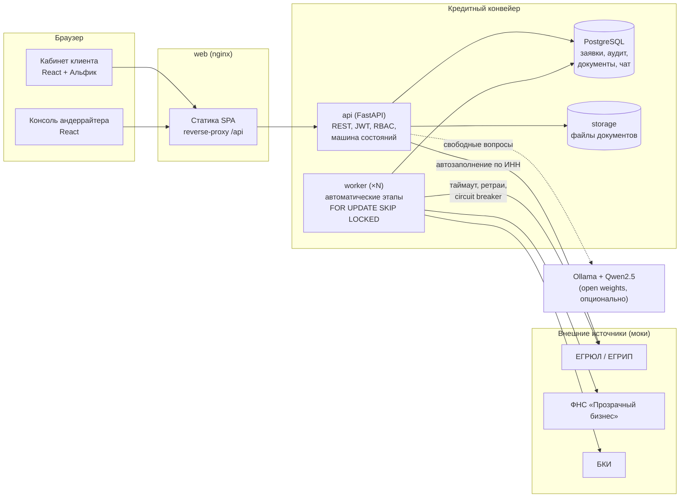

# Архитектура

## Компоненты



| Сервис | Технологии | Назначение |
|---|---|---|
| `web` | React 19, TypeScript, Vite, nginx | SPA кабинета клиента и консоли банка; проксирует `/api` |
| `api` | Python 3.12, FastAPI, SQLAlchemy 2, Pydantic 2 | REST API, авторизация, машина состояний, ассистент, лента |
| `worker` | тот же образ, `python -m app.worker` | Автоматические этапы конвейера; масштабируется `--scale worker=N` |
| `db` | PostgreSQL 16 | Хранилище заявок, журнала аудита, документов, уведомлений, чата |
| `mocks` | FastAPI | Симуляторы ЕГРЮЛ/ЕГРИП, ФНС «Прозрачный бизнес», БКИ |
| `ollama` (профиль `llm`) | Ollama + Qwen2.5 3B | Локальная open-weights LLM для свободных вопросов Альфику |

## Слои бэкенда

```
backend/app
├── api/            HTTP-слой: auth, client (кабинет), bank (консоль)
├── services/       Сценарии: pipeline (конвейер), applications, assistant, feed
├── domain/         Чистая бизнес-логика без I/O:
│   ├── state_machine.py   статусы и разрешённые переходы по ролям
│   ├── scoring.py         балльная модель риска (scorecard)
│   ├── decision.py        кредитная логика: стоп-факторы, лимит, контрпредложение
│   ├── readiness.py       «Каковы мои шансы?» на той же модели
│   ├── advisor.py         подбор продукта под задачу
│   ├── calculator.py      аннуитет, обратный расчёт, график
│   └── products.py        каталог продуктов и документов
├── integrations/   HTTP-клиенты внешних сервисов (таймауты, ретраи, circuit breaker)
├── models.py       ORM-модель данных
└── worker.py       цикл обработки конвейера
```

Доменный слой не зависит от БД и HTTP — он покрыт модульными тестами и может переиспользоваться (например, для пересчёта решений или A/B-сравнения моделей).

## Ключевые технические решения

| Требование | Решение |
|---|---|
| Последовательная смена состояний | Единственная точка перехода `pipeline.transition()`: проверка по таблице переходов и роли, журнал аудита, уведомление |
| Конкурентный доступ | Оптимистическая блокировка (`version`) — 409 при изменении заявки в другой вкладке/другим участником |
| Горизонтальное масштабирование | Воркеры берут задачи через `SELECT … FOR UPDATE SKIP LOCKED`; API stateless (JWT) |
| Отказоустойчивость интеграций | Таймаут 2 с, 3 ретрая с экспоненциальной паузой, circuit breaker; недоступность источника → заявка уходит специалисту, а не «падает» |
| Сбой этапа | 3 повторные попытки с backoff, затем ручное рассмотрение с записью в аудит |
| Трассировка | `X-Request-ID` в каждом ответе и в логах, журнал событий по заявке |
| Безопасность | JWT + RBAC (клиент видит только заявки своей компании), PBKDF2-хеши паролей, лимиты и белый список типов файлов, SHA-256 документов, непривилегированные пользователи в контейнерах, внутренние правила скоринга не раскрываются клиенту |
| Наблюдаемость | `/health/live`, `/health/ready` (проверка БД), healthcheck'и в Docker, метрики конвейера `/api/bank/metrics` |
| Воспроизводимость | `uv.lock`, `package-lock.json`, фиксированные версии образов |
| Конфигурация | Только переменные окружения (12-factor), см. `.env.example` |

## Где используется ИИ и почему

| Задача | Подход | Почему так |
|---|---|---|
| Статус, причины решения, документы, расчёт платежа | Правила (intent-матчинг) | Ответ должен быть точным и проверяемым; LLM здесь создаёт риск ошибки |
| Свободные вопросы предпринимателя | Локальная LLM Qwen2.5 (Apache-2.0) с контекстом заявки | Понятная ценность: объяснить простыми словами; ограничения в промпте + пост-фильтр против обещаний одобрения |
| Скоринг | Прозрачная балльная модель | Объяснимость для клиента и андеррайтера, регуляторные требования |

Без LLM прототип полностью работоспособен — ассистент отвечает по базе знаний.

## Путь до продакшена (что бы сделали дальше)

* Миграции схемы через Alembic (в MVP — `create_all` при старте).
* Очередь событий (Kafka/RabbitMQ) вместо опроса БД воркером; outbox-паттерн для уведомлений.
* Хранилище документов S3/MinIO, антивирусная проверка, OCR выписок.
* Интеграция с реальными ЕГРЮЛ/ФНС/БКИ через корпоративную шину; учёт согласий в отдельном сервисе.
* OIDC/SSO для сотрудников банка, ролевая модель с лимитами полномочий андеррайтеров.
* Метрики Prometheus, трассировка OpenTelemetry, централизованные логи.
* Мониторинг качества скоринга (Gini, PSI) и версионирование моделей.
