# Модель данных

ORM-описание: [`backend/app/models.py`](../backend/app/models.py). СУБД — PostgreSQL 16 (в тестах — SQLite). Результаты этапов конвейера хранятся в JSON-полях заявки: так сохраняется полный контекст решения (что пришло из источников, какие факторы и правила сработали) без отдельной таблицы под каждый источник.

```mermaid
erDiagram
    COMPANIES ||--o{ USERS : "сотрудники"
    COMPANIES ||--o{ APPLICATIONS : "заявки"
    USERS ||--o{ APPLICATIONS : "автор"
    APPLICATIONS ||--o{ APPLICATION_EVENTS : "аудит"
    APPLICATIONS ||--o{ DOCUMENTS : "документы"
    USERS ||--o{ NOTIFICATIONS : "уведомления"
    USERS ||--o{ CHAT_MESSAGES : "диалог с Альфиком"
    USERS ||--o{ FEED_INTERACTIONS : "реакции на ленту"

    COMPANIES {
        int id PK
        string inn UK "10 или 12 цифр"
        string ogrn
        string name
        string legal_form "ООО / ИП"
        string okved
        string industry "укрупнённая отрасль"
        string director
        string registered_at
    }
    USERS {
        int id PK
        string login UK
        string password_hash "PBKDF2"
        string role "client | underwriter"
        string full_name
        int company_id FK
    }
    APPLICATIONS {
        int id PK
        string number UK
        string status
        int version "оптимистическая блокировка"
        string product_code
        string purpose
        int amount
        int term_months
        bool has_collateral
        json form_data "анкета со слов клиента"
        json consents "ПДн, БКИ + id согласия"
        json precheck "результат «Каковы мои шансы?»"
        json data_check
        json enrichment "ответы ЕГРЮЛ, ФНС, БКИ"
        json scoring "балл, класс, факторы"
        json decision "исход, правила, причины"
        json offer "варианты условий"
        json requested_documents
        json signing
        json loan "договор, счёт, график"
        datetime next_run_at "когда воркеру взять заявку"
        int attempts
    }
    APPLICATION_EVENTS {
        int id PK
        int application_id FK
        string from_status
        string to_status
        string actor_type "client | system | underwriter"
        int actor_id
        string event_type
        string message
        json payload
        datetime created_at
    }
    DOCUMENTS {
        int id PK
        int application_id FK
        string doc_type
        string filename
        string sha256
        string status "UPLOADED | ACCEPTED | REJECTED"
    }
    NOTIFICATIONS {
        int id PK
        int user_id FK
        int application_id FK
        string title
        bool is_read
    }
    CHAT_MESSAGES {
        int id PK
        int user_id FK
        string role "user | assistant"
        string content
        string source "rules | llm | fallback"
    }
    FEED_INTERACTIONS {
        int id PK
        int user_id FK
        string item_id
        string action "open | like | hide"
    }
```

## Данные, которые переиспользуются по ходу процесса

| Данные | Где появляются | Где используются повторно |
|---|---|---|
| Ответы «Каковы мои шансы?» | `precheck`, `form_data` | Предзаполнение заявки — повторно не вводятся |
| Реквизиты из ЕГРЮЛ | Регистрация, шаг «Компания», этап `ENRICHMENT` | Карточка компании, отраслевой риск, персонализация ленты |
| Выручка ФНС / платежи БКИ | `enrichment` | Скоринг, сверка «со слов клиента vs источники» у андеррайтера |
| Факторы скоринга | `scoring` | Объяснение отказа клиенту, разбор у андеррайтера |
| Выбранный вариант предложения | `signing.option` | Договор, график, `loan` |
| Статус заявки | `status` | Трек, подсказки Альфика, лента, уведомления, очередь банка |
