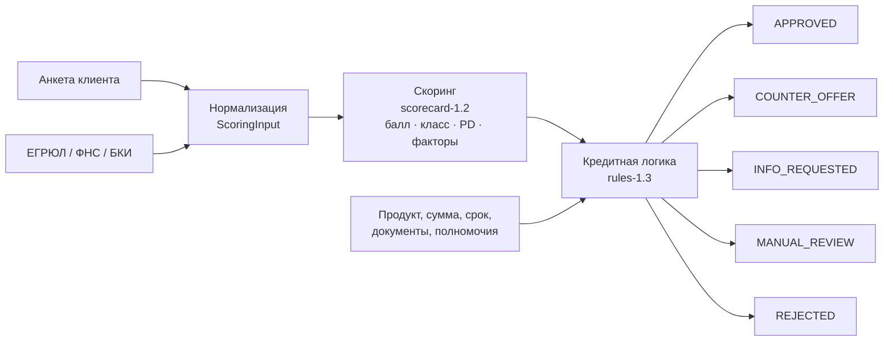

# Скоринг и модель кредитного решения

Кейс подчёркивает: **скоринг ≠ решение**. В прототипе это два независимых модуля.

## 1. Скоринг (`domain/scoring.py`)

Балльная карта: база **600** + вклад факторов, итог ограничен диапазоном 300–900.

| Фактор | Источник | Вклад |
|---|---|---|
| Срок работы бизнеса | ЕГРЮЛ | −120 (<6 мес.) … +80 (>5 лет) |
| Годовая выручка | ФНС | −40 (<3 млн) … +50 (>60 млн) |
| Сверка выручки клиента с ФНС | анкета + ФНС | −50 при расхождении >40% (0, если подтверждено выпиской), +15 если сходится |
| Долговая нагрузка (все платежи / свободный поток) | анкета + БКИ | +60 (≤30%) … −130 (>70%); −200 если поток ≤ 0 |
| Платёжная дисциплина (макс. просрочка за 12 мес.) | БКИ | +60 (нет) … −300 (>90 дней) |
| Длина кредитной истории | БКИ | −10 (нет) … +30 (≥24 мес. без просрочек) |
| Налоговая задолженность | ФНС | +20 (нет) … −100 (≥100 тыс.) |
| Отраслевой риск | ОКВЭД | +15 (общепит, медицина) … −25 (строительство) |
| Сумма к годовой выручке | заявка + ФНС | +10 (≤30%) … −60 (>50%) |
| Залог | заявка | +30 |
| Массовый адрес / дисквалификация руководителя | ЕГРЮЛ | −80 / −300 |

Классы риска: **A** ≥720 (PD 1%), **B** ≥650 (2,5%), **C** ≥580 (5%), **D** ≥500 (10%), **E** <500 (25%).

Каждый фактор возвращает объяснение и подсказку — они показываются клиенту в «Каковы мои шансы?» и при отказе, а андеррайтеру — в виде диаграммы вкладов.

## 2. Кредитная логика (`domain/decision.py`)

Порядок применения правил:

1. **Стоп-факторы → REJECTED**: компания не действует (ЕГРЮЛ), дисквалификация руководителя, просрочка >90 дней, отрицательный денежный поток, класс E. Клиент получает причину и советы.
2. **Соответствие продукту**: срок работы и требование к залогу. Не проходит — подбирается **альтернативный продукт** → COUNTER_OFFER.
3. **Подтверждение данных → INFO_REQUESTED**: расхождение выручки с ФНС >40% без выписки; небольшой налоговый долг без справки.
4. **Лимит**: `min(макс. продукта; PV(50% свободного потока − текущие платежи); 50% годовой выручки без залога / 100% с залогом)`; для овердрафта — 50% месячной выручки.
5. **Полномочия автоматики → MANUAL_REVIEW**: сумма > 10 млн ₽ (`AUTO_DECISION_LIMIT`), класс D, класс C при сумме > 3 млн, массовый адрес, налоговый долг ≥100 тыс. Андеррайтер видит рекомендацию движка (лимит, ставку, сумму).
6. **APPROVED**, если сумма ≤ лимита.
7. **COUNTER_OFFER**, если больше: варианты «та же сумма на больший срок», «больше денег на максимальный срок», «меньшая сумма на тот же срок» — клиент выбирает сам.

Ставка: `базовая ставка продукта + надбавка за класс риска (A 0 … D +5 п.п.) − 2 п.п. за залог` (для продуктов с необязательным залогом).

## 2а. Учёт банковской выписки

Если клиент загрузил выписку 1С / CSV и она разобрана, обороты считаются подтверждёнными (фактор сверки с ФНС не штрафует). Если очищенные поступления по выписке ниже заявленной выручки более чем на 15%, в скоринг и расчёт лимита идёт **выручка по выписке** — консервативный подход банка. Из поступлений исключаются переводы со своих счетов и полученные займы.

## 3. Предварительная оценка «Каковы мои шансы?» (`domain/readiness.py`)

Использует **ту же** балльную модель, но на ответах клиента и без запроса в БКИ (согласия ещё нет). Балл переводится в шкалу готовности 0–100: высокая (≥70) / средняя (≥45) / низкая. Показываются блокирующие условия продукта, факторы «помогает / мешает», советы и комфортная сумма. Всегда выводится дисклеймер: это ориентир, а не обещание одобрения.

## Допущения

Веса и пороги экспертные и иллюстративные: модель не обучена на реальных данных. В продакшене веса калибруются на исторических выдачах (логистическая регрессия / WoE), качество отслеживается по Gini и PSI, версии моделей (`model_version`, `engine_version`) сохраняются в каждой заявке для воспроизводимости решения.
