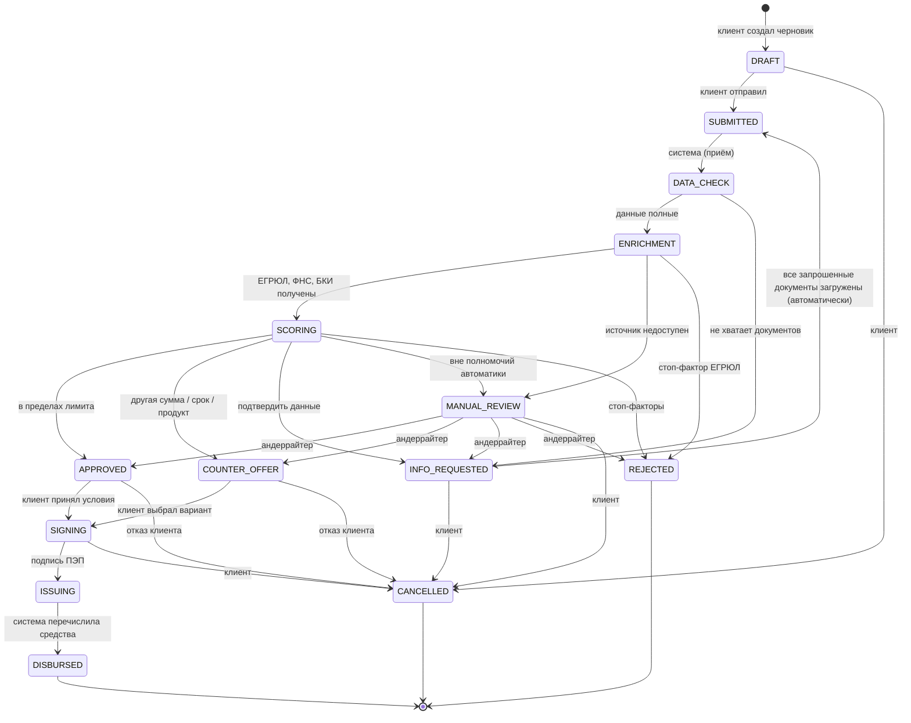

# Диаграмма состояний заявки

Переходы описаны в [`backend/app/domain/state_machine.py`](../backend/app/domain/state_machine.py). Любой другой переход отклоняется (HTTP 409), каждый успешный — пишется в журнал аудита.

| Статус | Для клиента | Кто двигает дальше |
|---|---|---|
| `DRAFT` | Черновик | Клиент |
| `SUBMITTED` | Заявка отправлена | Воркер |
| `DATA_CHECK` | Проверка данных | Воркер |
| `ENRICHMENT` | Запрос сведений ЕГРЮЛ, ФНС, БКИ | Воркер |
| `SCORING` | Оценка и решение | Воркер |
| `MANUAL_REVIEW` | Рассматривает специалист | Андеррайтер |
| `INFO_REQUESTED` | Нужны дополнительные данные | Клиент |
| `APPROVED` | Одобрено | Клиент |
| `COUNTER_OFFER` | Предложены другие условия | Клиент |
| `SIGNING` | Подписание договора | Клиент |
| `ISSUING` | Выдача средств | Воркер |
| `DISBURSED` | Средства выданы | — (финал) |
| `REJECTED` | Отказ | — (финал) |
| `CANCELLED` | Отменена | — (финал) |

Клиенту показывается укрупнённый трек из 5 шагов: **Заявка → Проверка → Решение → Подписание → Деньги на счёте**, а внутри шага «Проверка» — детальные подэтапы в реальном времени.
